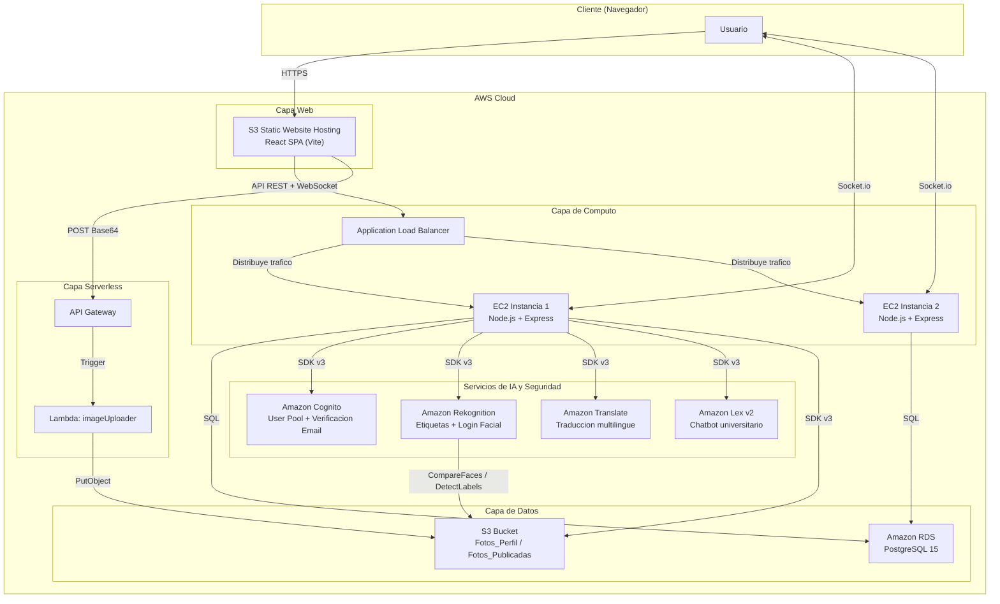

# Semi-Social

> Red social universitaria desplegada en AWS con autenticacion Cognito, reconocimiento facial, chat en tiempo real, traduccion automatica y chatbot integrado.

[](https://nodejs.org/)
[](https://react.dev/)
[](https://www.postgresql.org/)
[](https://aws.amazon.com/)

---

## Tabla de Contenidos

- [Semi-Social](#semi-social)
  - [Tabla de Contenidos](#tabla-de-contenidos)
  - [Descripcion](#descripcion)
  - [Tecnologias Principales](#tecnologias-principales)
  - [Arquitectura General](#arquitectura-general)
  - [Estructura del Repositorio](#estructura-del-repositorio)
  - [Requisitos Previos](#requisitos-previos)
  - [Configuracion y Ejecucion Local](#configuracion-y-ejecucion-local)
    - [1. Clonar y preparar el entorno](#1-clonar-y-preparar-el-entorno)
    - [2. Levantar el stack completo con Docker](#2-levantar-el-stack-completo-con-docker)
    - [3. Comandos utiles](#3-comandos-utiles)
    - [4. Desarrollo local (sin Docker)](#4-desarrollo-local-sin-docker)
  - [Documentacion](#documentacion)
  - [Integrantes](#integrantes)

---

## Descripcion

**Semi-Social** es una aplicacion web tipo red social desarrollada como proyecto final del curso *Seminario de Sistemas 1* (ECYS). Permite a los usuarios registrarse con verificacion por correo, iniciar sesion con credenciales o reconocimiento facial, publicar imagenes con etiquetas automaticas, gestionar amistades, chatear en tiempo real y traducir contenido entre varios idiomas.

La aplicacion esta disenada para ejecutarse completamente en la nube de AWS, utilizando una combinacion de servicios serverless, infraestructura tradicional y servicios de inteligencia artificial.

---

## Tecnologias Principales

| Capa | Tecnologia | Descripcion |
|---|---|---|
| **Frontend** | React 19 + Vite + TailwindCSS 4 | SPA moderna con soporte para WebSockets |
| **Backend** | Node.js + Express 5 | API REST + Socket.io para tiempo real |
| **Base de Datos** | PostgreSQL 15 | Docker local / Amazon RDS en produccion |
| **Autenticacion** | Amazon Cognito | Registro, confirmacion por email y login seguro |
| **Almacenamiento** | Amazon S3 | Imagenes de perfil y publicaciones |
| **Reconocimiento** | Amazon Rekognition | Etiquetado automatico y login facial |
| **Traduccion** | Amazon Translate | Traduccion de publicaciones y comentarios |
| **Chatbot** | Amazon Lex v2 | Asistente virtual sobre la Facultad de Ingenieria |
| **Serverless** | API Gateway + Lambda | Pipeline de carga de imagenes a S3 |
| **Infraestructura** | EC2 + ALB + S3 Static Hosting | Balanceo de carga y hosting web |

---

## Arquitectura General



> Para el diagrama detallado y la documentacion completa de la arquitectura, consulta el [Manual Tecnico](./docs/tec-manual.md).

---

## Estructura del Repositorio

```
SEMINARIO1_A_1S2026_G5/
├── backend/              # API REST (Node.js + Express)
│   ├── aws-services/     # Clientes AWS SDK v3
│   ├── config/           # Configuracion de BD y entorno
│   ├── controllers/      # Logica de negocio por dominio
│   ├── database/         # Schema SQL (PostgreSQL)
│   └── routes/           # Definicion de endpoints
├── frontend/             # SPA (React 19 + Vite + TailwindCSS)
│   ├── public/           # Favicon y assets estaticos
│   └── src/
│       ├── components/   # Componentes reutilizables
│       ├── pages/        # Vistas principales
│       └── services/     # Clientes HTTP y logica de API
├── lambdas/              # Funciones AWS Lambda (serverless)
├── bruno/                # Coleccion de requests para pruebas
├── db/                   # Diagrama ER y schema DBML
├── docs/                 # Documentacion del proyecto
│   ├── tec-manual.md     # Manual tecnico completo
│   ├── user-manual.md    # Manual de usuario
│   ├── statement.md      # Enunciado del proyecto
│   └── img_aws/          # Evidencias de configuracion AWS
├── docker-compose.yml    # Stack completo para desarrollo
├── .env.example          # Plantilla de variables de entorno
└── README.md             # Este archivo
```

---

## Requisitos Previos

- [Node.js](https://nodejs.org/) 20+ y npm
- [Docker](https://www.docker.com/) y Docker Compose
- Cuenta de AWS con credenciales configuradas
- Git

---

## Configuracion y Ejecucion Local

### 1. Clonar y preparar el entorno

```bash
git clone <url-del-repositorio>
cd SEMINARIO1_A_1S2026_G5
cp .env.example .env
# Edita .env con tus credenciales de AWS y configuraciones
```

### 2. Levantar el stack completo con Docker

```bash
# Construir y ejecutar todos los servicios
docker compose up -d --build
```

Servicios disponibles:

| Servicio | URL | Descripcion |
|---|---|---|
| Frontend | http://localhost:3000 | Aplicacion React |
| Backend API | http://localhost:5000 | API REST + Socket.io |
| PostgreSQL | localhost:5432 | Base de datos local |

### 3. Comandos utiles

```bash
# Ver logs en tiempo real
docker compose logs -f

# Detener servicios
docker compose down

# Reiniciar con base de datos limpia
docker compose down -v
docker compose up -d --build
```

### 4. Desarrollo local (sin Docker)

```bash
# 1. Levantar solo la base de datos
docker compose up -d db

# 2. Backend (en otra terminal)
cd backend
npm install
npm run dev        # Nodemon en puerto 5000

# 3. Frontend (en otra terminal)
cd frontend
npm install
npm run dev        # Vite en puerto 3000
```

---

## Documentacion

| Documento | Descripcion |
|---|---|
| [Manual Tecnico](./docs/tec-manual.md) | Arquitectura completa, endpoints, schema de BD, flujos funcionales, configuracion AWS y comandos de despliegue |
| [Manual de Usuario](./docs/user-manual.md) | Guia paso a paso para usar la aplicacion con capturas de pantalla |
| [Enunciado del Proyecto](./docs/statement.md) | Requisitos originales, rubrica de calificacion y cronograma |
| [Coleccion Bruno](./bruno/) | Requests de prueba para todos los endpoints de la API |

---

## Integrantes

| Carne | Nombre |
|---|---|
| 202302220 | Enner Esai Mendizabal Castro |
| 202200129 | Luis Pablo Manuel Garcia Lopez |
| 202000886 | Jose Ricardo Menocal Kong |
| 202006633 | Katherin Alejandra Galvez Chiroy |
| 202300601 | Diego Alessandro Constanza Padilla |
| 202300636 | Jose Emilio Morales Castillo |

---

> **Universidad de San Carlos de Guatemala** - Facultad de Ingenieria - Escuela de Ciencias y Sistemas  
> *Seminario de Sistemas 1 - Abril 2026*
