# Manual Técnico — Semi-Social

> **Versión:** 1.0  
> **Fecha:** Abril 2026  
> **Estado:** Proyecto Finalizado

---

## 1. Integrantes
- 202302220 - Enner Esai Mendizabal Castro
- 202200129 - Luis Pablo Manuel Garcia Lopez
- 202000886 - Jose Ricardo Menocal Kong
- 202006633 - Katherin Alejandra Galvez Chiroy
- 202300601 - Diego Alessandro Constanza Padilla
- 202300636 - Jose Emilio Morales Castillo

---

## 2. Resumen Arquitectónico

La solución sigue una arquitectura **SPA + API REST + Servicios AWS**:

| Capa | Tecnología | Descripción |
|---|---|---|
| Frontend | React (Vite) + TailwindCSS | SPA en `frontend/` |
| Backend | Node.js + Express | API REST en `backend/` |
| Base de datos | PostgreSQL 15 | Docker local / RDS en producción |
| Almacenamiento | Amazon S3 | Imágenes de perfil y posts |
| Autenticación | Amazon Cognito | Registro, confirmación por email y login |
| Reconocimiento | Amazon Rekognition | Login facial y etiquetado de imágenes |
| Traducción | Amazon Translate | Traduce descripciones y comentarios independientemente |
| Chatbot | Amazon Lex v2 | Bot informativo universitario |
| Chat en tiempo real | Socket.io | Mensajes + presencia online en tiempo real |

### Diagrama de Arquitectura

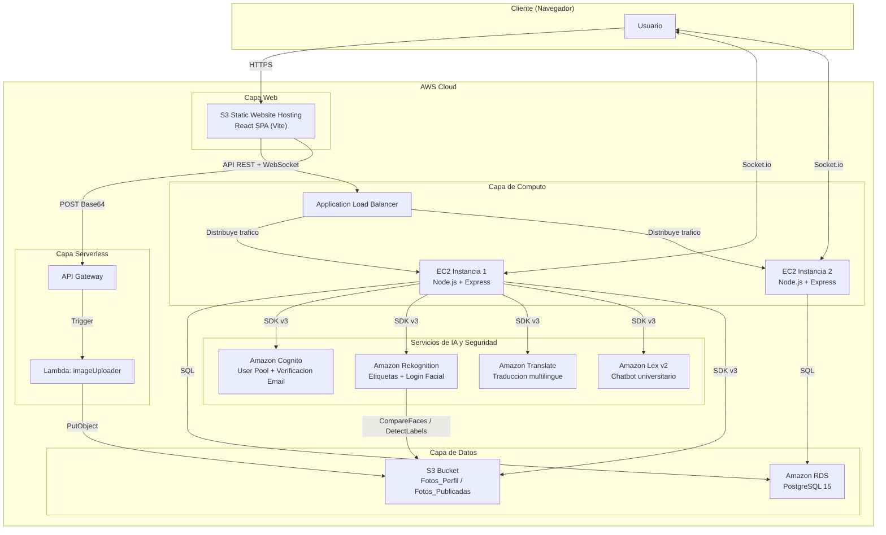

---

## 3. Estructura Principal de Código

> El repositorio está organizado en tres grandes áreas: `frontend/`, `backend/` e infraestructura serverless en `lambdas/`.

```
/
│   .cursorrules
│   .env
│   .env.example
│   .gitignore
│   docker-compose.yml
│   LICENSE
│   login.json
│   README.md
│   register.json
│   
├───.github
│   │   copilot-instructions.md
│   │   
│   ├───instructions
│   │       antigravity.instructions.md
│   │       
│   └───skills
│       ├───aws-integration
│       │       SKILL.md
│       │       
│       └───db-queries
│               SKILL.md
│               
├───backend
│   │   .dockerignore
│   │   Dockerfile
│   │   index.js
│   │   package-lock.json
│   │   package.json
│   │   register.json
│   │   register_body.json
│   │   register_response.json
│   │   
│   ├───aws-services
│   │       .gitkeep
│   │       cognito.js
│   │       imageUpload.js
│   │       lex.js
│   │       rekognition.js
│   │       translate.js
│   │       
│   ├───config
│   │       .gitkeep
│   │       db.js
│   │       env.js
│   │       
│   ├───controllers
│   │       .gitkeep
│   │       authController.js
│   │       chatController.js
│   │       postsController.js
│   │       usersController.js
│   │       
│   ├───database
│   │       schema.sql
│   │       
│   └───routes
│           auth.js
│           chat.js
│           posts.js
│           users.js
│           
├───bruno
│       01-health.bru
│       02-auth-register.bru
│       03-auth-login.bru
│       04-posts-create.bru
│       05-posts-list.bru
│       06-users-send-request.bru
│       07-chat-direct-room.bru
│       08-chat-send-message.bru
│       09-ai-translate.bru
│       10-ai-chatbot.bru
│       bruno.json
│       environments.local.json
│       
├───Db
│       schema.dbml
│       schema.pdf
│       schema.png
│       
├───docs
│   │   statement.md
│   │   tec-manual.md
│   │   user-manual.md
│   │
│   ├───imgs
│   │    ├───user
│   │    │    00-docker-desktop.png
│   │    │    01-home.png
│   │    │    02-register.png
│   │    │    03-verify-empty.png
│   │    │    04-email-code.png
│   │    │    05-verify-filled.png
│   │    │    06-login.png
│   │    │    07-feed-empty.png
│   │    │    08-creating-post.png
│   │    │    09-post-published.png
│   │    │    10-post-translation.png
│   │    │    11-friends-add.png
│   │    │    12-friends-request-sent.png
│   │    │    13-friends-pending.png
│   │    │    14-friends-accepted.png
│   │    │    15-friends-list.png
│   │    │    16-chats-empty.png
│   │    │    17-new-chat-modal.png
│   │    │    18-chat-conversation.png
│   │    │    19-view-profile.png
│   │    │    20-edit-profile.png
│   │    │    21-profile-updated.png
│   │    │    22-extra.png
│   │            
│   ├───img_aws
│   │    ├───apigateway
│   │    │    creacion-integracion-api-http.png
│   │    │    definicion-rutas-metodos.png
│   │    │    configuracion-entorno-despliegue.png
│   │    │    resumen-revision-infraestructura.png
│   │    │    prueba-integracion-carga-imagen-s3.png
│   │    ├───cognito
│   │    │    configuracion-inicial-user-pool.png
│   │    │    configuracion-atributos-obligatorios.png
│   │    │    extension-esquema-atributos-custom.png
│   │    │    vista-general-esquema-autenticacion.png
│   │    ├───lambda
│   │    │    configuracion-basica-funcion-serverless.png
│   │    │    logica-procesamiento-decodificacion-imagenes.png
│   │    │    configuracion-capas-personalizadas.png
│   │    │    definicion-rol-ejecucion-politicas.png
│   │    ├───lex
│   │    │    creacion-configuracion-basica-bot.png
│   │    │    configuracion-regional-voz.png
│   │    │    definicion-intencion-subirimagen.png
│   │    │    entrenamiento-enunciados-usuario.png
│   │    │    configuracion-variables-entrada-slots.png
│   │    │    personalizacion-valores-slots.png
│   │    │    enumeracion-valores-sinonimos-slot.png
│   │    │    flujo-confirmacion-accion.png
│   │    │    respuesta-final-finalizacion-tarea.png
│   │    │    manejo-respuestas-cierre-excepciones.png
│   │    │    generacion-entrenamiento-modelo-lenguaje.png
│   │    │    entorno-pruebas-integrado-playground.png
│   │    │    validacion-flujo-conversacional-datos.png
│   │    │    analisis-json-depuracion-respuesta.png
│   │    └───s3
│   │         ├───storage
│   │         │       configuracion-contenedor-objetos.png
│   │         │       gestion-bloqueo-acceso-publico.png
│   │         │       organizacion-archivos-almacenamiento.png
│   │         │       gestion-metadatos-objetos-almacenados.png
│   │         │       
│   │         └───web
│   │                 configuracion-static-website-hosting.png
│   │                 configuracion-permisos-lectura-publica.png
│   │                 despliegue-activos-web-bucket.png
│   │           
├───frontend
│   │   .dockerignore
│   │   Dockerfile
│   │   index.html
│   │   package-lock.json
│   │   package.json
│   │   tailwind.config.js
│   │   vite.config.js
│   │   
│   ├───public
│   │       favicon.svg
│   │       
│   └───src
│       │   App.jsx
│       │   index.css
│       │   main.jsx
│       │   
│       ├───assets
│       │       fondoFriends.png
│       │       fotoNotFound.png
│       │       logo.png
│       │       profile1.png
│       │       profile2.png
│       │       profile3.png
│       │       
│       ├───components
│       │   │   .gitkeep
│       │   │   
│       │   ├───ChatbotWidget
│       │   │       ChatbotWidget.jsx
│       │   │       
│       │   ├───NavBar
│       │   │       NavBar.jsx
│       │   │       
│       │   ├───Toast
│       │   │       Toast.jsx
│       │   │       
│       │   └───WebcamCapture
│       │           WebcamCapture.jsx
│       │           
│       ├───pages
│       │   │   .gitkeep
│       │   │   
│       │   ├───Chats
│       │   │       Chats.jsx
│       │   │       
│       │   ├───Feed
│       │   │       Feed.jsx
│       │   │       
│       │   ├───Friends
│       │   │       Friends.jsx
│       │   │       
│       │   ├───Home
│       │   │       Home.jsx
│       │   │       
│       │   ├───Login
│       │   │       Login.jsx
│       │   │       
│       │   ├───NotFound
│       │   │       NotFound.jsx
│       │   │       
│       │   ├───Profile
│       │   │       Profile.jsx
│       │   │       
│       │   └───Register
│       │           Register.jsx
│       │           
│       └───services
│               .gitkeep
│               aiService.js
│               api.js
│               authService.js
│               chatService.js
│               postsService.js
│               session.js
│               usersService.js
│               
└───lambdas
        deploy-instructions.md
        imageUploader.js
        package.json
        template.yaml
```

---

## 4. Variables de Entorno

Archivo único `.env` en la raíz del repositorio.

| Variable | Descripción |
|---|---|
| `DB_HOST` | Host de PostgreSQL (`db` en Docker, `localhost` en host) |
| `DB_PORT` | Puerto PostgreSQL (default: 5432) |
| `DB_USER` | Usuario de BD |
| `DB_PASSWORD` | Contraseña de BD |
| `DB_NAME` | Nombre de la BD |
| `AWS_REGION` | Región AWS (ej: `us-east-1`) |
| `AWS_ACCESS_KEY_ID` | Clave de acceso AWS |
| `AWS_SECRET_ACCESS_KEY` | Clave secreta AWS |
| `COGNITO_USER_POOL_ID` | Pool ID de Cognito |
| `COGNITO_CLIENT_ID` | Client ID de Cognito |
| `COGNITO_CLIENT_SECRET` | Client Secret (si aplica) |
| `S3_BUCKET_IMAGES` | Nombre del bucket S3 para imágenes |
| `LEX_BOT_ID` | ID del bot Lex v2 |
| `LEX_BOT_ALIAS_ID` | Alias del bot Lex |
| `LEX_LOCALE_ID` | Locale del bot (ej: `es_419`) |
| `CLIENT_URL` | URL del frontend (CORS origin) |
| `FACIAL_MATCH_THRESHOLD` | Umbral de similitud facial (default: 90) |

---

## 5. Endpoints Implementados

### 5.1 Auth / IA (`/api/auth`)

| Método | Ruta | Descripción |
|---|---|---|
| POST | `/register` | Registro Cognito + inserción local + upload foto S3 |
| POST | `/confirm` | Confirma usuario Cognito por código. **Actualiza `cognito_confirmed = TRUE` en DB** |
| POST | `/login` | Login por credenciales via Cognito |
| POST | `/login-facial` | Login facial comparando contra S3 via Rekognition |
| POST | `/labels` | Detección de etiquetas (URL o base64) |
| POST | `/translate` | Traducción de texto genérica |
| POST | `/chatbot` | Mensaje a Amazon Lex v2 |
| POST | `/logout` | Logout frontend (limpia localStorage) |

### 5.2 Publicaciones (`/api/posts`)

| Método | Ruta | Descripción |
|---|---|---|
| GET | `/` | Lista posts — **filtra por `userId` para mostrar solo amigos + propios** — soporta `tag`, `q`, `limit` |
| GET | `/:id` | Detalle de publicación |
| POST | `/` | Crea post con imagen (S3 + Rekognition automático) |
| PUT | `/:id` | Actualiza descripción |
| DELETE | `/:id` | Elimina post propio |
| POST | `/:id/comments` | Agrega comentario |
| POST | `/:id/translate` | Traduce descripción **o** un comentario específico (`commentId` en body) |

### 5.3 Usuarios / Amigos (`/api/users`)

| Método | Ruta | Descripción |
|---|---|---|
| GET | `/` | Lista usuarios **confirmados** (`cognito_confirmed = TRUE`). Soporta `q` para búsqueda |
| GET | `/:id` | Perfil de usuario |
| PUT | `/:id` | Actualiza perfil — **requiere contraseña actual para validar** |
| DELETE | `/:id` | Elimina usuario |
| GET | `/:id/friends` | Amigos aceptados |
| GET | `/:id/friend-requests` | Solicitudes pendientes entrantes |
| POST | `/:id/friend-requests` | Enviar solicitud (`senderId` → `receiverId`) |
| PATCH | `/friend-requests/:requestId` | Responde solicitud (`accept`/`reject`) |

### 5.4 Chat (`/api/chat`)

| Método | Ruta | Descripción |
|---|---|---|
| GET | `/rooms?userId=` | Salas del usuario |
| POST | `/direct-room` | Obtiene o crea sala directa entre dos usuarios |
| GET | `/messages/:room?userId=` | Mensajes de una sala |
| POST | `/messages` | Persiste mensaje |

---

## 6. Flujo Funcional Detallado

### Registro y Confirmación
1. Usuario envía datos + foto → backend sube imagen a S3, crea usuario en Cognito, inserta en `users` con `cognito_confirmed = FALSE`.
2. Cognito envía código al correo del usuario.
3. Usuario ingresa el código en `/confirm` → backend confirma en Cognito y **actualiza `cognito_confirmed = TRUE` en PostgreSQL**.
4. A partir de ese momento el usuario aparece en "Nuevos Usuarios" para otros.

### Filtrado del Feed por Amigos
- `GET /api/posts?userId=X` ejecuta un subquery sobre `friendships` para incluir solo posts del usuario `X` y sus amigos con `status = 'accepted'`.

### Traducción Independiente (descripción vs comentario)
- `POST /api/posts/:id/translate` con solo `{ targetLanguageCode }` traduce la **descripción**.
- `POST /api/posts/:id/translate` con `{ targetLanguageCode, commentId }` traduce ese **comentario específico**.
- El frontend monta un componente `DescriptionTranslate` y un `CommentTranslate` por separado, cada uno con su propio estado `[activeLang, translated, loading]`.

### Presencia Online (Socket.io)
- Al cargar `Chats.jsx`, el frontend emite `user_online(userId)`.
- El backend registra el `userId` en un `Set` en memoria y emite `online_users([...ids])` a todos los clientes.
- Al desconectarse el socket, el backend elimina el usuario del Set y notifica a todos.
- Los indicadores de "En línea" / "Desconectado" se actualizan en tiempo real.

### Búsqueda de Amigos
- El componente `Friends.jsx` usa un debounce de 350ms para llamar a `GET /api/users?currentUserId=X&q=texto`.
- El backend busca `LOWER(username) LIKE %q%` OR `LOWER(full_name) LIKE %q%`.

---

## 7. Schema de Base de Datos (principales tablas)

```sql
-- Usuarios (solo cognito_confirmed = TRUE son visibles en "Nuevos Usuarios")
CREATE TABLE users (
  id SERIAL PRIMARY KEY,
  username VARCHAR(50) UNIQUE NOT NULL,
  full_name VARCHAR(100) NOT NULL,
  email VARCHAR(100) UNIQUE NOT NULL,
  cognito_sub VARCHAR(255) UNIQUE,
  cognito_confirmed BOOLEAN NOT NULL DEFAULT FALSE,
  dpi VARCHAR(20) UNIQUE NOT NULL,
  password_md5 CHAR(32) NOT NULL,
  profile_image_url TEXT NOT NULL,
  face_image_url TEXT,
  created_at TIMESTAMP DEFAULT CURRENT_TIMESTAMP
);

-- Amistades
CREATE TABLE friendships (
  id SERIAL PRIMARY KEY,
  sender_id INT REFERENCES users(id),
  receiver_id INT REFERENCES users(id),
  status VARCHAR(20) DEFAULT 'pending', -- pending | accepted | rejected
  created_at TIMESTAMP DEFAULT CURRENT_TIMESTAMP,
  responded_at TIMESTAMP
);

-- Posts, Tags, Post_Tags, Comments (omitidos por brevedad — ver schema.sql completo)
```

---

## 8. Decisiones Arquitectónicas

1. **Controladores por dominio** — `auth`, `posts`, `users`, `chat` — para aislar lógica de rutas.
2. **Clientes AWS v3 modulares** — cada servicio AWS en su propio archivo en `aws-services/`.
3. **Queries parametrizadas** con `pg` para prevenir SQL injection.
4. **`cognito_confirmed`** — columna booleana en `users`, actualizada al confirmar el código. Evita depender de Cognito en cada petición de listado.
5. **Presencia en memoria** — `Set` en `index.js` para usuarios online. Simple y sin latencia extra de BD. Al reiniciar el servidor el Set se vacía; los clientes reenvían `user_online` al reconectar el socket.
6. **Traducción granular** — componentes React independientes por descripción y por comentario para evitar rerender global y permitir estados de carga/activo individuales.
7. **Búsqueda con debounce** — 350ms de espera antes de disparar la petición al backend para evitar carga innecesaria.
8. **CORS con PATCH** — `methods: ['GET','POST','PUT','PATCH','DELETE']` — necesario para el endpoint `PATCH /friend-requests/:id`.

---

## 9. Colección Bruno

La carpeta `bruno/` incluye requests para probar:
- Health
- Register / Confirm / Login / Login Facial
- Create/List posts (con `userId` para filtrar amigos)
- Translate post / Translate comment
- Friend request (send / answer)
- Direct room + send message
- Chatbot

Entorno recomendado: `bruno/environments.local.json`.

---

## 10. Infraestructura AWS Desplegada

> A continuación se documenta la configuración y despliegue de cada servicio AWS utilizado en la arquitectura cloud del proyecto.

### API Gateway

#### 1. Creación e Integración de la API HTTP
Se establecen los detalles básicos de la API (`api-gateway-semis1-g5`), el tipo de
direccionamiento IP (IPv4) y la integración directa con la función Lambda `image-u`
mediante su ARN en la región `us-east-1`.

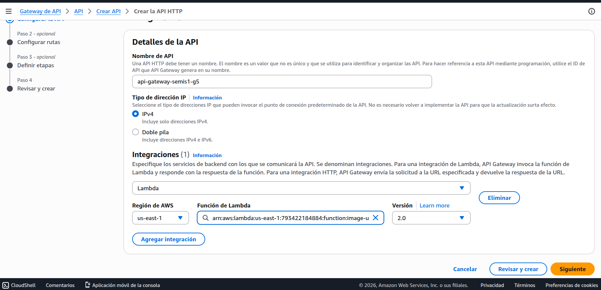

---

#### 2. Definición de Rutas y Métodos
Se define el endpoint `/upload` con método POST, redirigiendo automáticamente
las solicitudes hacia la integración `image-uploader` (función Lambda).

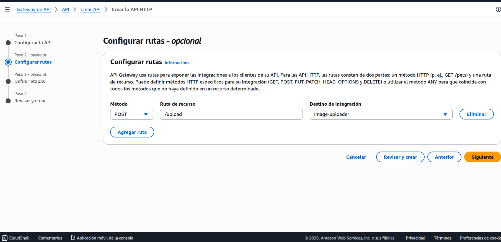

---

#### 3. Configuración del Entorno de Despliegue
Configuración de la etapa predeterminada `$default` con Auto-deploy habilitado,
permitiendo que los cambios en la API se apliquen de forma inmediata.

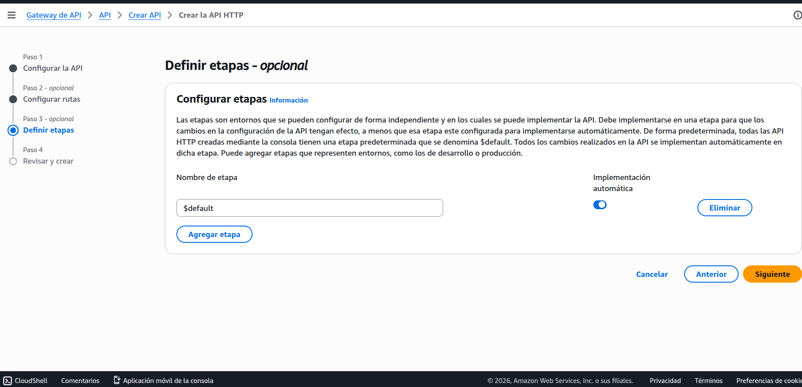

---

#### 4. Resumen y Revisión de la Infraestructura
Vista consolidada de la configuración final: API `api-gateway-semis1-g5` con la
ruta `POST /upload` apuntando a la Lambda y despliegue automático activo.

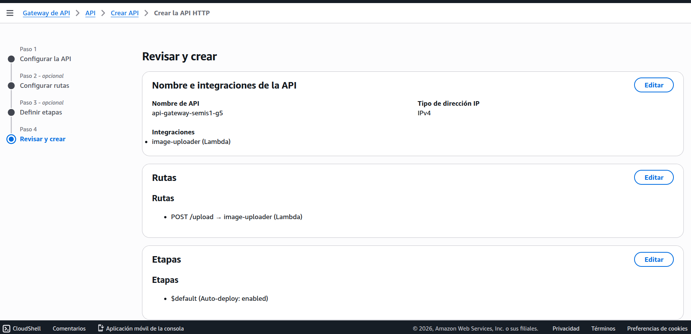

---

#### 5. Prueba de Integración: Carga de Imagen a S3 vía API Gateway
Prueba con cliente de API enviando un POST con imagen en Base64. La respuesta
`200 OK` retorna una URL de S3 (`semi1proyecto-g5-jemc.s3.amazonaws.com`),
confirmando el flujo completo: API Gateway → Lambda → S3.

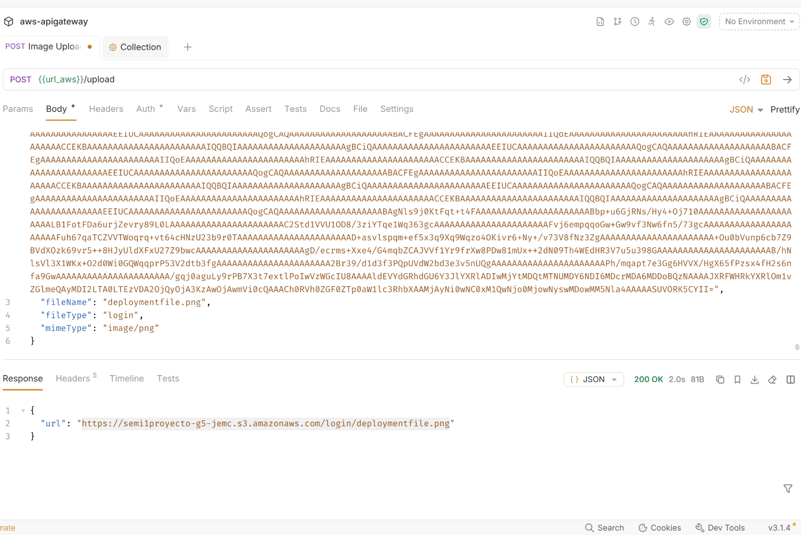

### Cognito

#### 1. Configuración Inicial del User Pool y Aplicación Cliente
Se define el tipo de aplicación "Traditional web application" bajo el nombre `Semis1-social`,
configurando el correo electrónico como identificador principal de inicio de sesión.

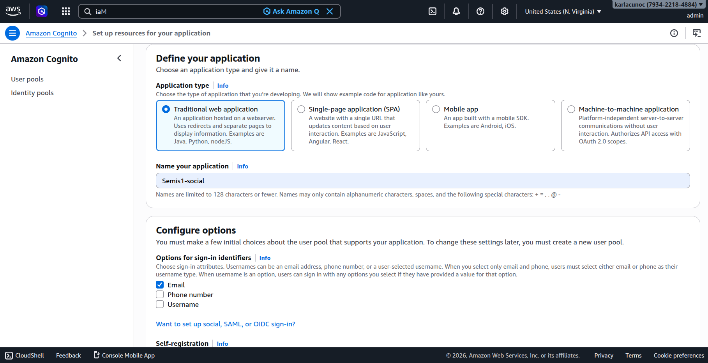

---

#### 2. Configuración de Atributos Obligatorios para el Registro
Se habilita el auto-registro y se definen como obligatorios los atributos estándar:
`email`, `family_name`, `given_name` y `picture`.

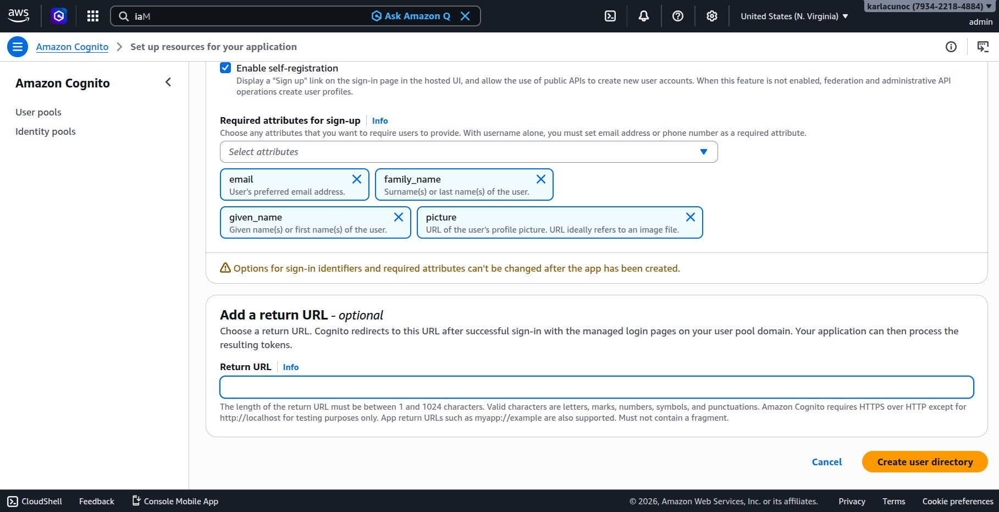

---

#### 3. Extensión del Esquema de Usuario con Atributos Custom
Se agrega el atributo personalizado `dpi` de tipo `Number` con la propiedad
"Mutable", permitiendo su modificación después de la creación de la cuenta.

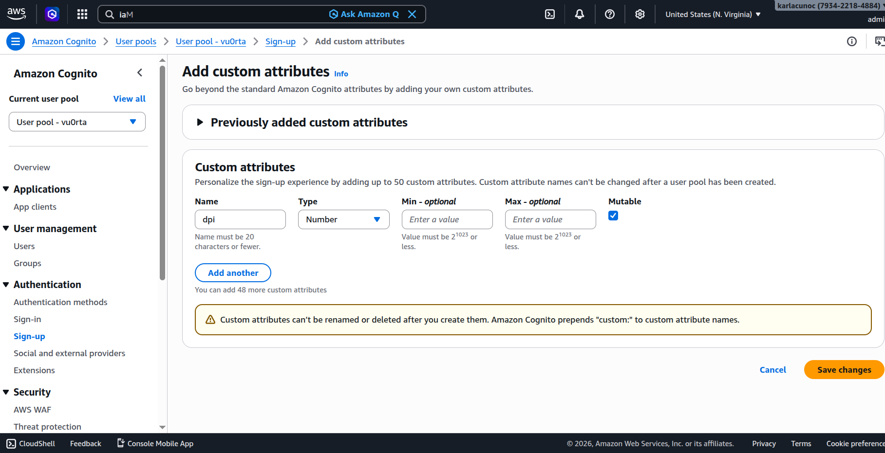

---

#### 4. Vista General del Esquema de Autenticación
Resumen consolidado que confirma los atributos estándar obligatorios, el atributo
`custom:dpi` y el registro de autoservicio habilitado.

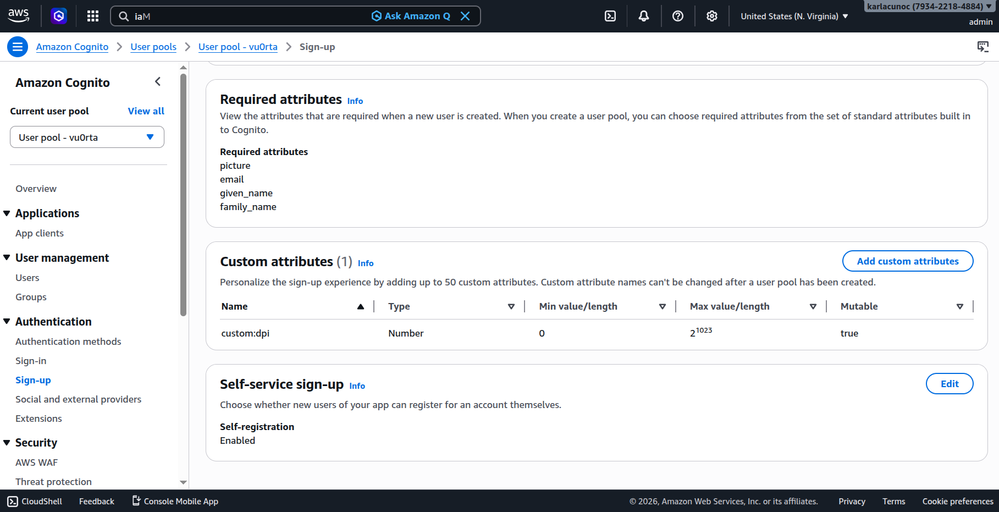

---

### Lambda

#### 1. Configuración Básica de la Función Serverless
Creación de la función `image-uploader` con runtime Node.js 24.x y arquitectura
x86_64 para el manejo eficiente de operaciones de E/S asíncronas.

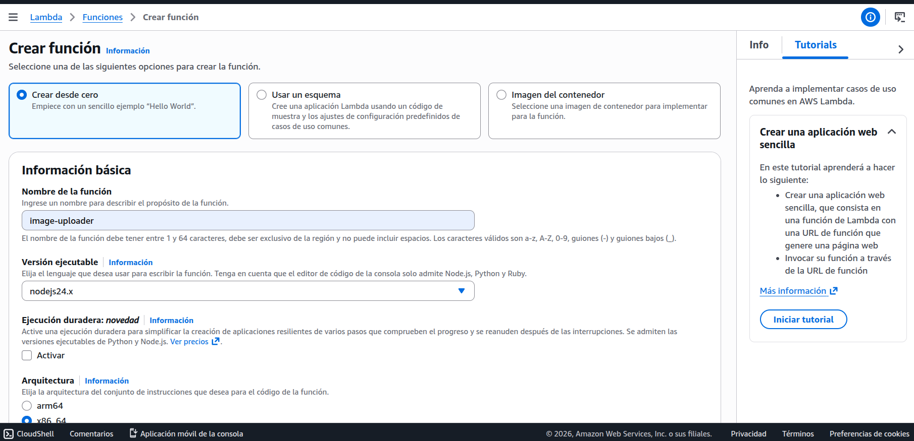

---

#### 2. Lógica de Procesamiento y Decodificación de Imágenes
El handler importa el SDK de AWS para S3, extrae la imagen codificada en Base64
del body JSON y la convierte en buffer binario para su almacenamiento.

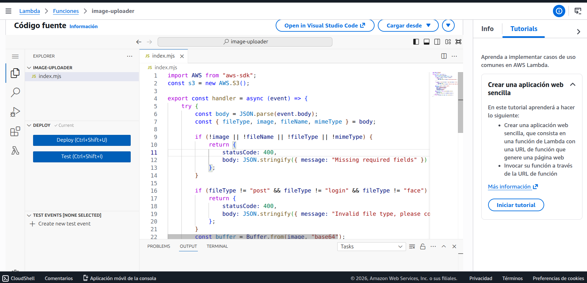

---

#### 3. Configuración de Capas Personalizadas para Dependencias
Se agrega la capa `image-uploader` en su Versión 1, manteniendo las librerías
separadas del código principal para facilitar reutilización y mantenimiento.

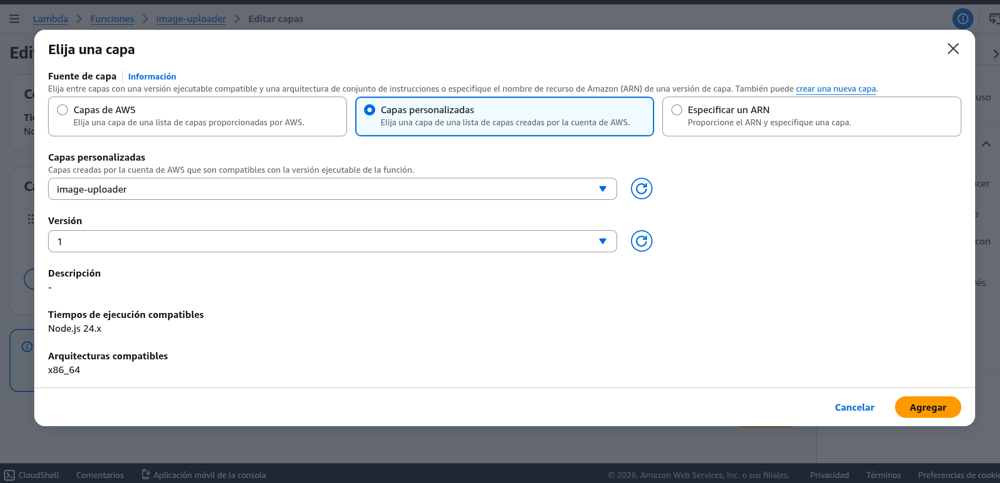

---

#### 4. Definición del Rol de Ejecución y Políticas de Acceso
El rol IAM `image-uploader-role` asigna las políticas `AmazonS3FullAccess` y
`AWSLambdaBasicExecutionRole`, habilitando escritura en S3 y logs en CloudWatch.

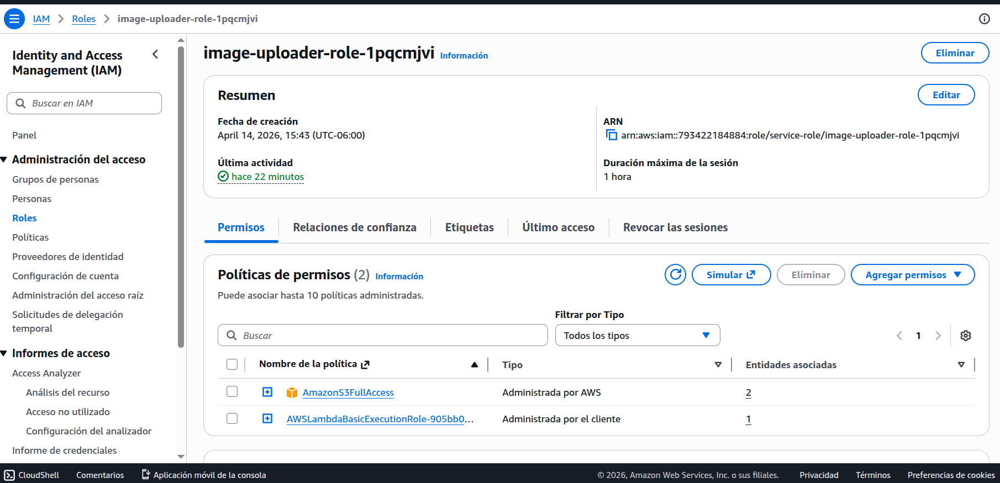

---

### Amazon Lex

#### 1. Creación y Configuración Básica del Bot
Configuración inicial del bot `ImageBot` con rol IAM de servicio, ajustes COPPA
y tiempo de sesión inactiva definido.

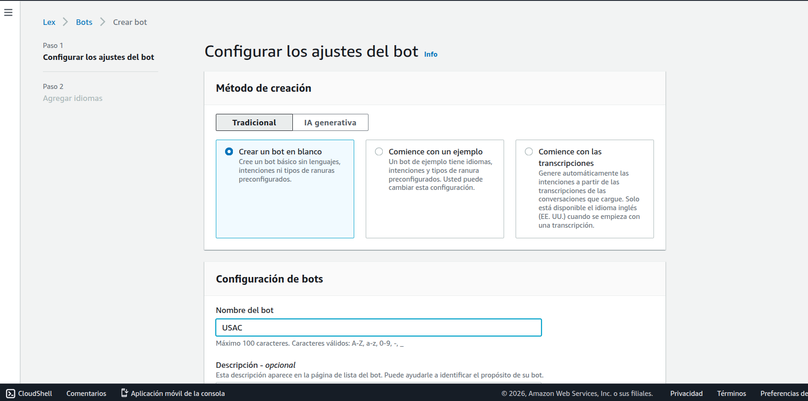

---

#### 2. Configuración Regional y de Interacción por Voz
Selección del idioma "Español (US)" y motor de voz Text-to-Speech para adaptar
el bot al público objetivo con respuestas en lenguaje natural.

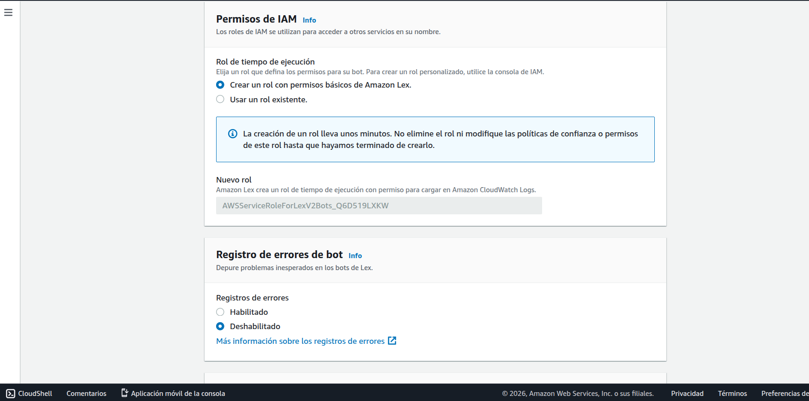

---

#### 3. Definición de la Intención Principal: `SubirImagen`
Creación de la intención `SubirImagen` que actúa como disparador para el flujo
completo de carga de archivos en la aplicación.

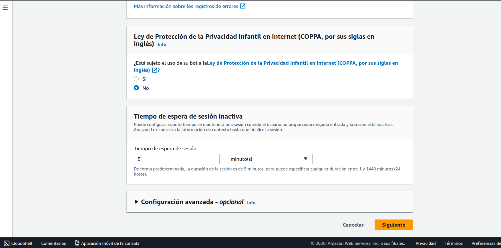

---

#### 4. Entrenamiento del Bot con Enunciados de Usuario
Configuración de frases como "Quiero subir una imagen" o "Subir foto" para
entrenar el modelo NLP en el reconocimiento de variaciones de lenguaje natural.

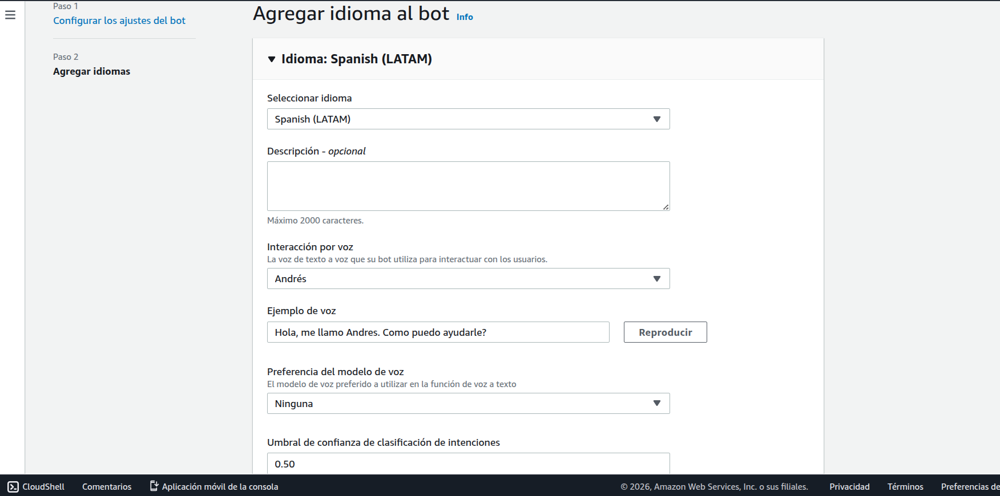

---

#### 5. Configuración de Variables de Entrada (Slots)
Definición de los datos que el bot recolecta activamente, como nombre de imagen
o tipo, actuando como parámetros de entrada para completar la acción.

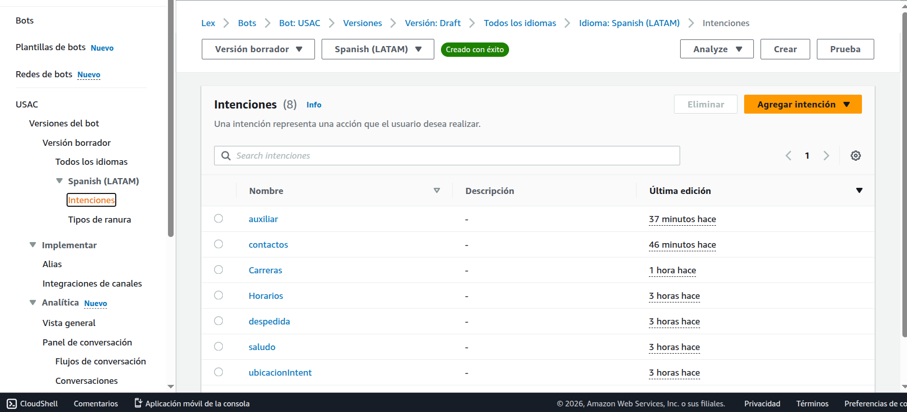

---

#### 6. Personalización de Valores para Slots
Creación de un tipo de slot a medida para restringir las respuestas del usuario
a valores específicos y garantizar la integridad de los datos recibidos.

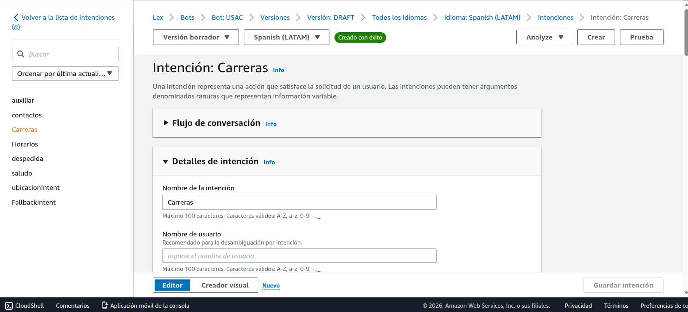

---

#### 7. Enumeración de Valores y Sinónimos del Slot
Definición de opciones como "Perfil", "Post" o "Banner" con sus sinónimos,
mapeando entradas del usuario a valores estándar procesables por Lambda.

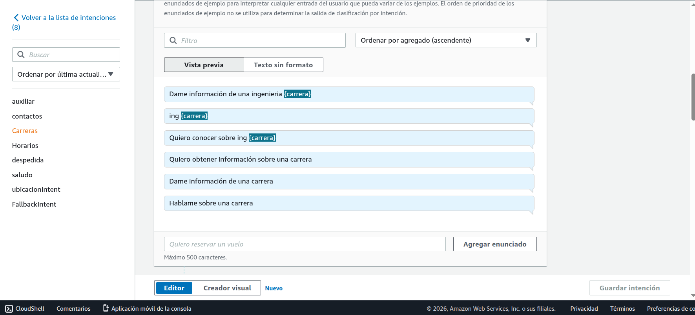

---

#### 8. Flujo de Confirmación de la Acción
Configuración del mensaje de confirmación previo a la ejecución final, dando
al usuario la oportunidad de validar los datos recolectados por el bot.

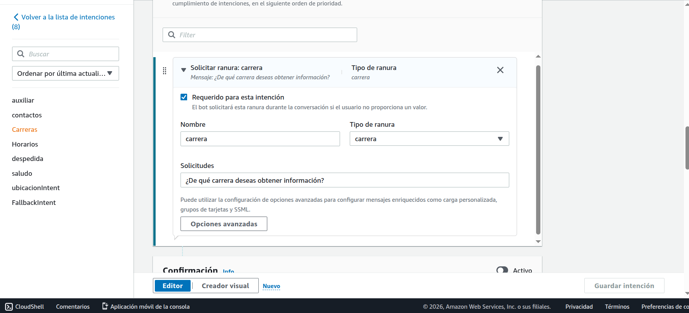

---

#### 9. Respuesta Final y Finalización de la Tarea
Definición del mensaje de éxito que cierra el ciclo conversacional informando
al usuario que su solicitud fue procesada correctamente.

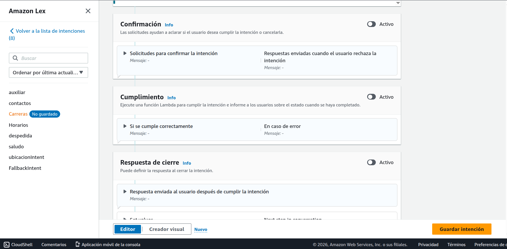

---

#### 10. Manejo de Respuestas de Cierre y Excepciones
Configuración de mensajes para cuando el usuario cancela la operación,
manteniendo la fluidez conversacional en escenarios incompletos.

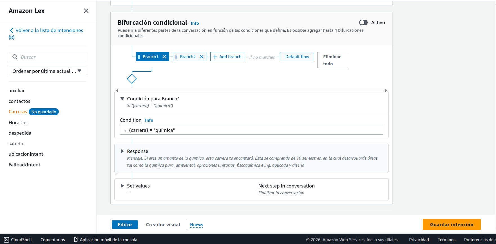

---

#### 11. Generación y Entrenamiento del Modelo de Lenguaje
Proceso de Build donde AWS Lex compila intenciones, frases y slots en un modelo
de aprendizaje automático funcional listo para pruebas.

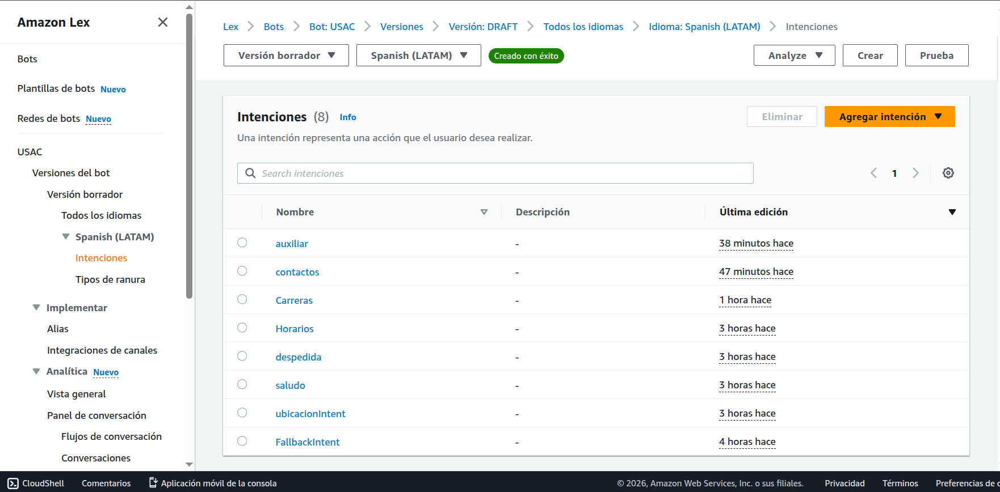

---

#### 12. Entorno de Pruebas Integrado (Playground)
Apertura del panel de pruebas para interactuar con el bot en tiempo real usando
la versión Draft, sin necesidad de despliegue externo.

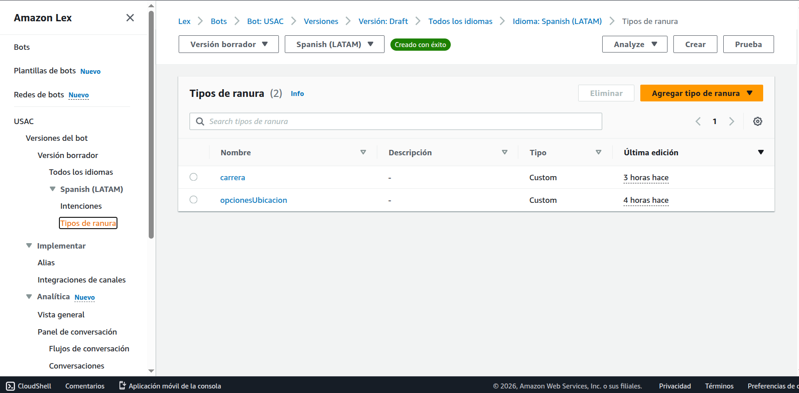

---

#### 13. Validación de Flujo Conversacional y Recolección de Datos
El usuario envía "Hola" y el bot activa la intención configurada, solicitando
el primer slot y confirmando el reconocimiento correcto de disparadores.

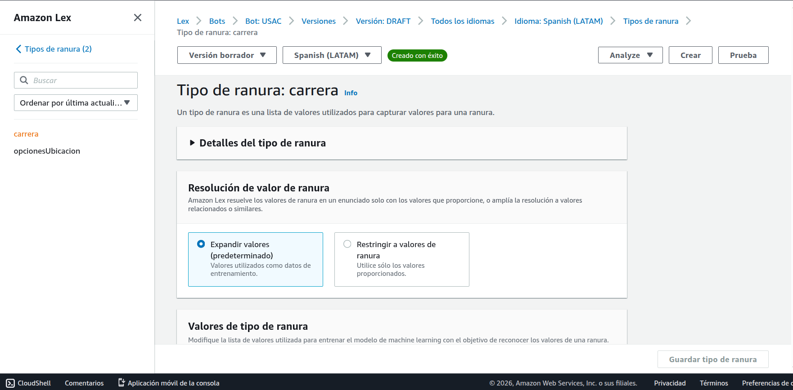

---

#### 14. Análisis de JSON y Depuración de la Respuesta
Vista del panel Inspect con estado de intención, slots detectados y nivel de
confianza del modelo para verificar el objeto JSON enviado a Lambda.

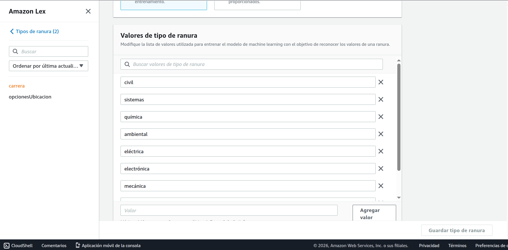

---

### S3 — Almacenamiento de Imágenes

#### 1. Configuración del Contenedor de Objetos (S3 Bucket)
Creación del bucket `semi1proyecto-g5-jemc` en `us-east-1`, asegurando baja
latencia al coincidir con la región del resto de los servicios.

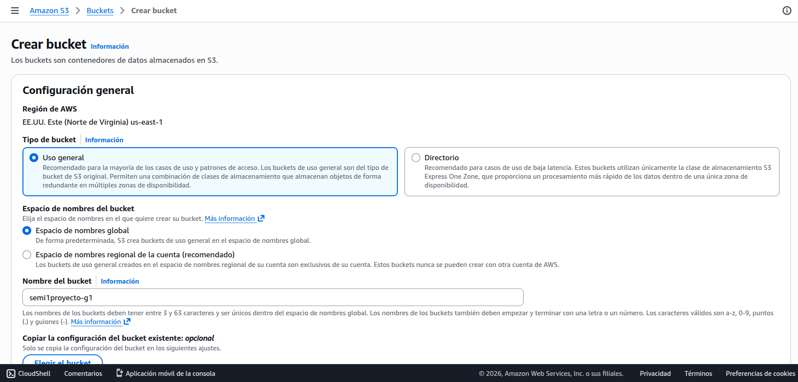

---

#### 2. Gestión de Bloqueo de Acceso Público
Configuración de "Block Public Access" para permitir lectura de objetos vía URL
manteniendo el equilibrio entre accesibilidad y seguridad.

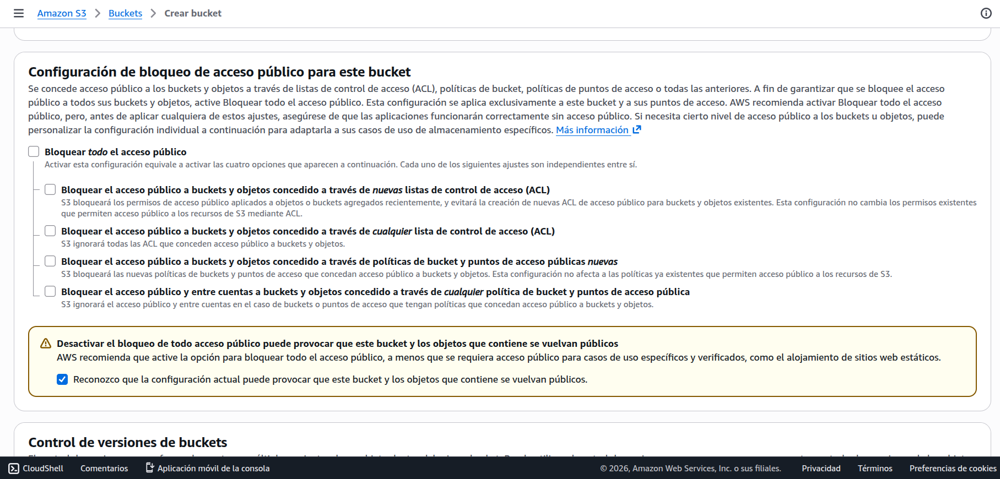

---

#### 3. Organización de Archivos en el Almacenamiento
Vista del bucket mostrando el prefijo `login/` que categoriza las imágenes
subidas y facilita la administración por carpeta.

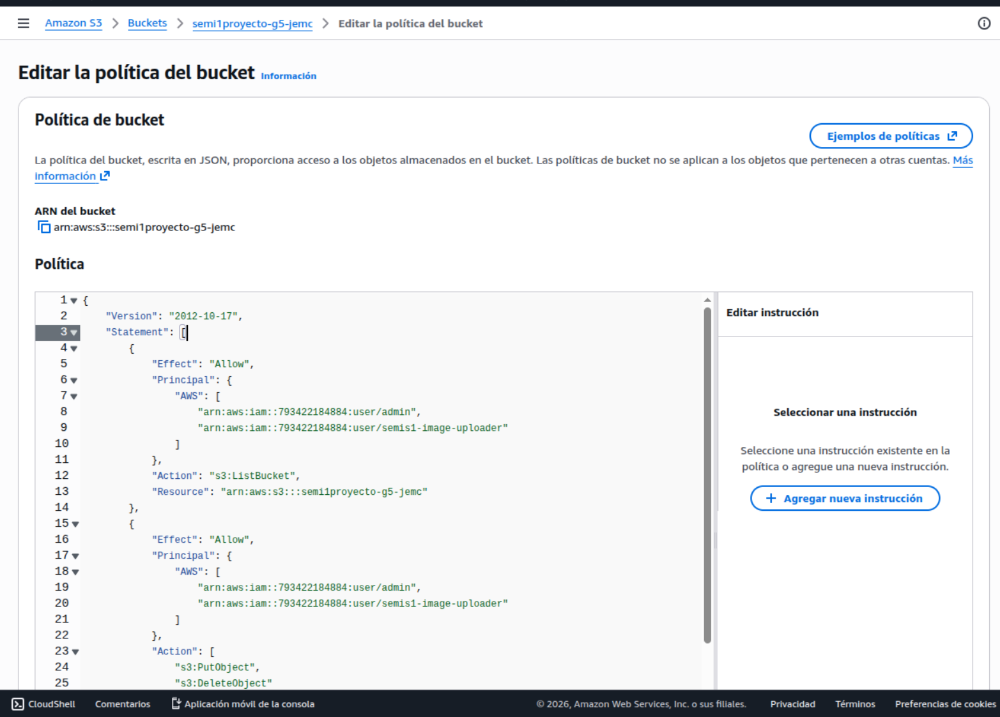

---

#### 4. Gestión y Metadatos de Objetos Almacenados
Vista detallada del prefijo `login/` con el archivo `deploymentfile.png`,
confirmando el flujo completo API Gateway → Lambda → S3.

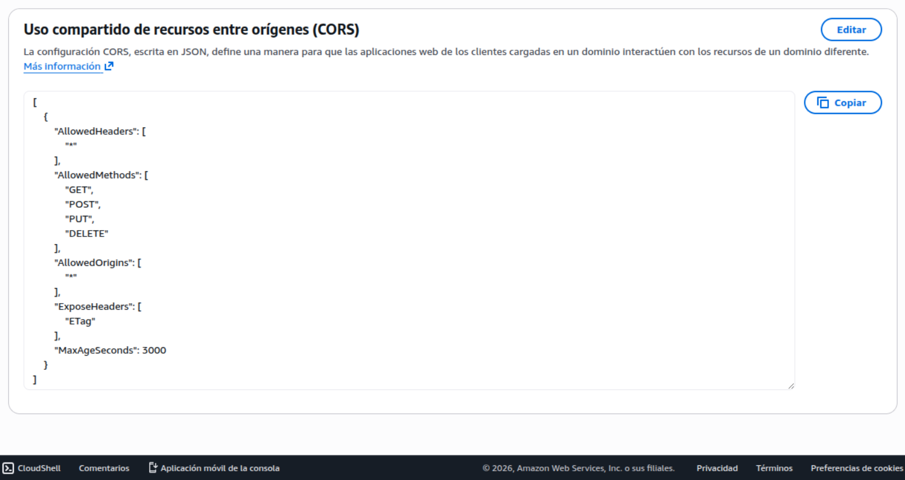

---

### S3 — Alojamiento Web

#### 1. Configuración de Static Website Hosting
Activación del alojamiento estático con `index.html` como documento de entrada,
generando un endpoint HTTP público sin necesidad de servidores EC2.

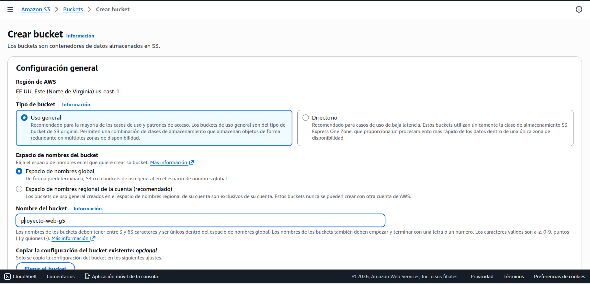

---

#### 2. Configuración de Permisos de Lectura Pública (JSON Policy)
Política de bucket con `Principal: "*"` y `Action: "s3:GetObject"` para que
los navegadores puedan descargar HTML, CSS y JS sin error de acceso denegado.

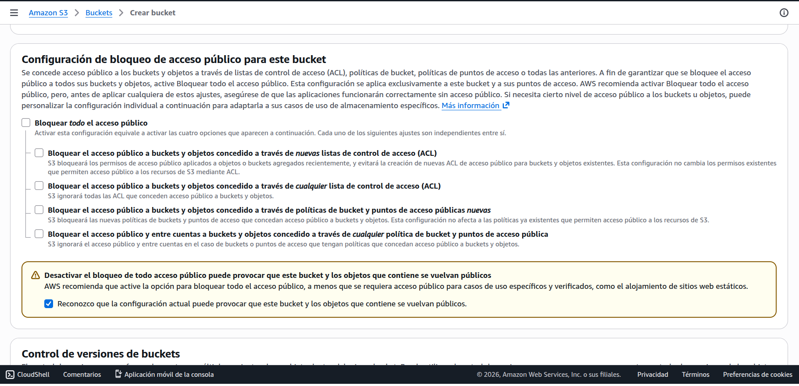

---

#### 3. Despliegue de Activos Web en el Bucket
Lista de archivos cargados incluyendo `index.html` y recursos del front-end,
confirmando la arquitectura serverless completa del proyecto.

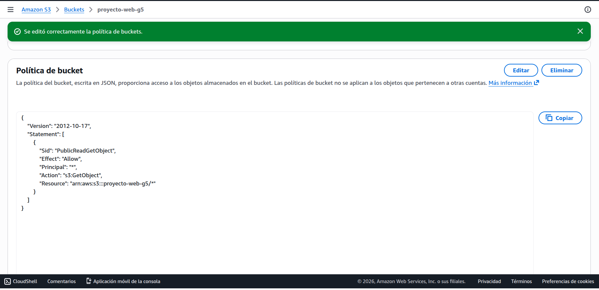
---

## 11. Comandos de Ejecución

### Stack Docker completo (recomendado)
```bash
docker compose down -v          # Detiene y elimina volúmenes (DB limpia)
docker compose up -d --build    # Construye y levanta todos los contenedores
```

### Local (desarrollo)
```bash
# Levantar solo la BD en Docker
docker compose up -d db

# Backend
cd backend && npm run dev

# Frontend
cd frontend && npm run dev
```

> El frontend queda disponible en `http://localhost:3000` y el backend en `http://localhost:5000`.

---

## 12. Estado Final del Proyecto

| Módulo | Estado |
|---|---|
| Auth (registro / login / facial) | ✅ Implementado |
| Confirmación Cognito + marcado en DB | ✅ Implementado |
| Publicaciones / comentarios / tags Rekognition | ✅ Implementado |
| Filtro feed solo amigos | ✅ Implementado |
| Traducción descripción (independiente) | ✅ Implementado |
| Traducción comentarios (independiente por comentario) | ✅ Implementado |
| Gestión amigos + búsqueda en tiempo real | ✅ Implementado |
| Solicitudes aceptar/rechazar (CORS PATCH fix) | ✅ Implementado |
| Chat en tiempo real (Socket.io) | ✅ Implementado |
| Presencia online real (En línea / Desconectado) | ✅ Implementado |
| Favicon SS personalizado | ✅ Implementado |
| Despliegue cloud final (API Gateway, Lambda, S3, Cognito, Lex) | ✅ Implementado |

---

## 13. Conclusión

El proyecto **Semi-Social** ha sido desarrollado y desplegado exitosamente, cumpliendo con todos los requisitos funcionales y técnicos establecidos. La arquitectura serverless implementada sobre AWS garantiza escalabilidad, bajo costo operativo y alta disponibilidad. Cada servicio cloud está correctamente configurado, integrado y documentado, lo que permite una mantenibilidad a largo plazo y facilita futuras extensiones del sistema.

