# Manual de Usuario — Semi-Social

Bienvenido a la red social universitaria **Semi-Social**, una plataforma interactiva y escalable impulsada por servicios de Inteligencia Artificial de AWS. En este manual encontrarás, paso a paso, cómo utilizar todas las funcionalidades de la plataforma.

---

## 1. Registro de Nueva Cuenta

Para poder interactuar con la plataforma, primero debes crear una cuenta.

### Pasos:
1. Accede a la página principal de la plataforma (`localhost:3000` en entorno local).
2. Selecciona la opción **Registrarse**.
3. Rellena el formulario con tus datos:
   - **Nombre completo**
   - **Correo electrónico** (deberá ser válido y accesible)
   - **DPI** (13 dígitos, Documento Personal de Identidad)
   - **Contraseña segura** (mínimo 8 caracteres, debe incluir mayúscula, número y carácter especial)
4. Tómate una foto o sube una imagen para tu foto de perfil. **Esta foto será utilizada también para tu inicio de sesión facial.**
5. Haz clic en **Crear cuenta**.
6. Recibirás un **código de verificación** en tu correo. Ingrésalo en la pantalla de confirmación que aparecerá a continuación.

> ⚠️ **Importante:** Tu cuenta solo quedará activa y visible para otros usuarios **después** de confirmar el código de tu correo. Si no confirmas, no aparecerás listado en la plataforma.

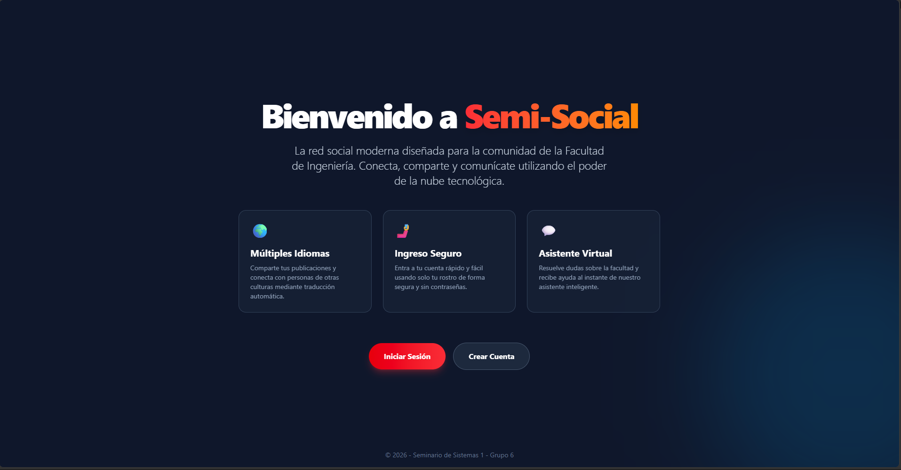

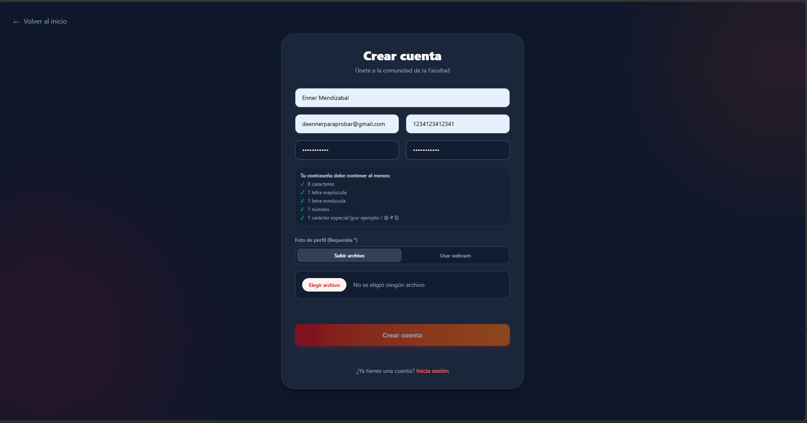

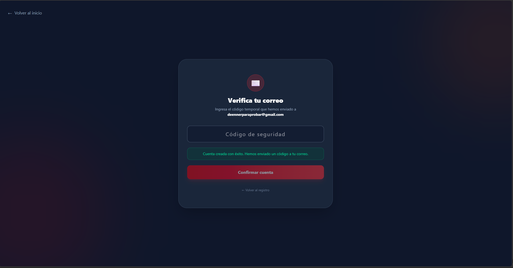

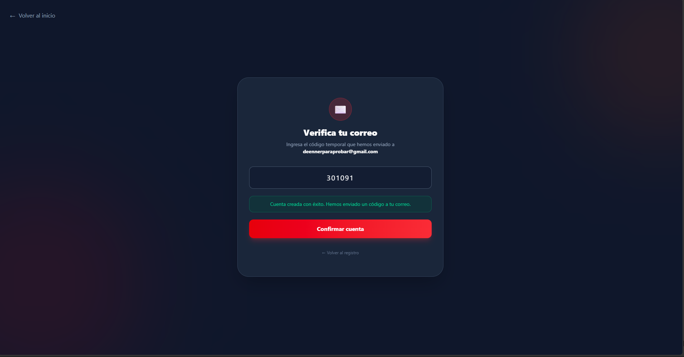

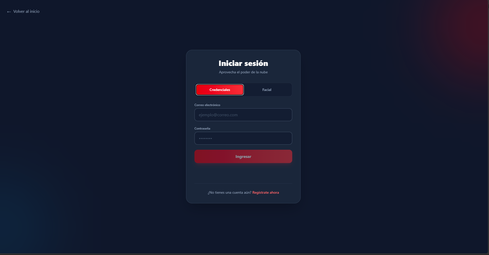

---

## 2. Iniciar Sesión

Puedes acceder a tu cuenta utilizando credenciales clásicas o, de manera rápida, mediante reconocimiento facial.

### Iniciar sesión con Credenciales:
1. Dirígete a la pestaña de **Login**.
2. Ingresa tu correo electrónico (o nombre de usuario) y tu contraseña.
3. Haz clic en **Iniciar Sesión**.

### Iniciar sesión con Reconocimiento Facial (Face Login):
1. Selecciona la opción **Login Facial** en la pantalla de inicio.
2. Permite el acceso a tu cámara web.
3. Tómate una foto. El sistema usará **Amazon Rekognition** para comparar tu rostro con tu foto de perfil. Si coincide (por encima del umbral de similitud configurado), accederás inmediatamente.

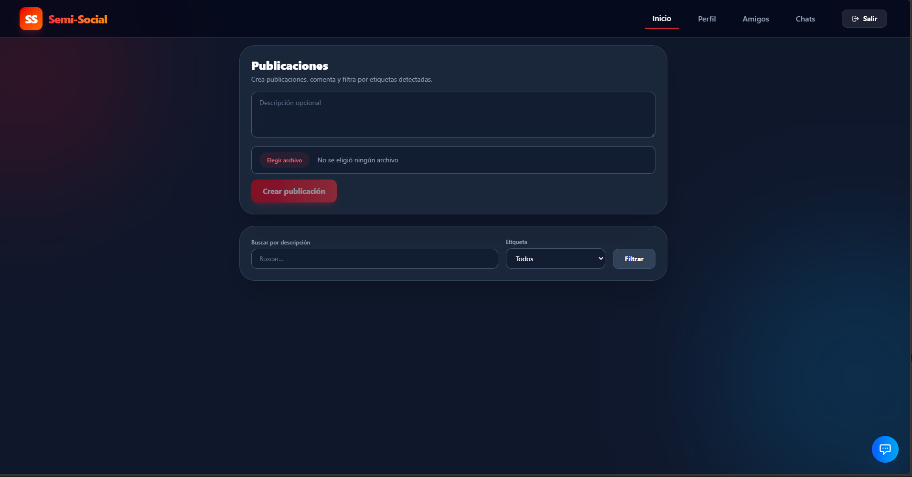

---

## 3. Feed Principal (Publicaciones)

El **Feed** es el corazón de Semi-Social. Aquí verás únicamente las publicaciones de **ti mismo y de tus amigos confirmados**.

### Crear una publicación:
1. En la parte superior del Feed, encontrarás el panel **"Publicaciones"**.
2. Escribe una descripción (opcional).
3. Selecciona la imagen que deseas publicar (obligatorio).
4. Haz clic en **Crear publicación**.

> Las imágenes son analizadas por **Amazon Rekognition** al publicarlas. Se detectan etiquetas automáticamente (ej: "Persona", "Vehículo", "Naturaleza") que aparecen como tags en tu publicación.

### Filtros inteligentes:
- **Buscar por descripción:** Usa el campo de texto para buscar publicaciones por su descripción.
- **Filtrar por etiqueta:** Selecciona una etiqueta del desplegable y haz clic en **Filtrar** para ver únicamente esas publicaciones.

### Comentar:
- Abajo de cada publicación, escribe tu comentario y presiona **Enviar**.

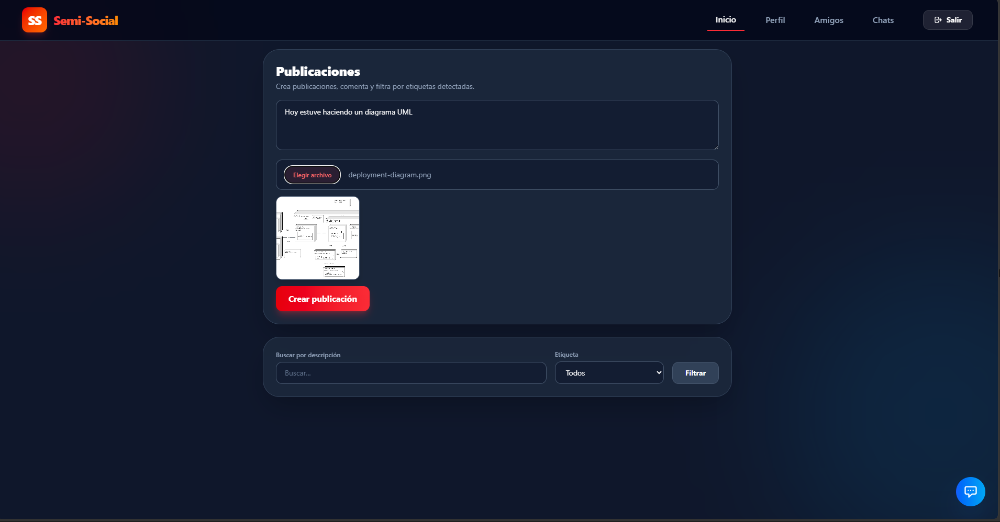

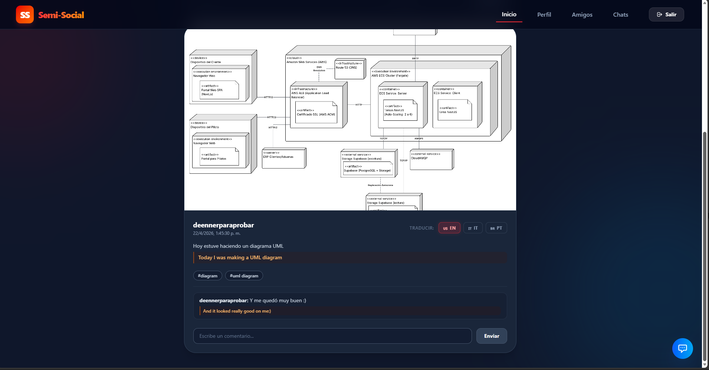

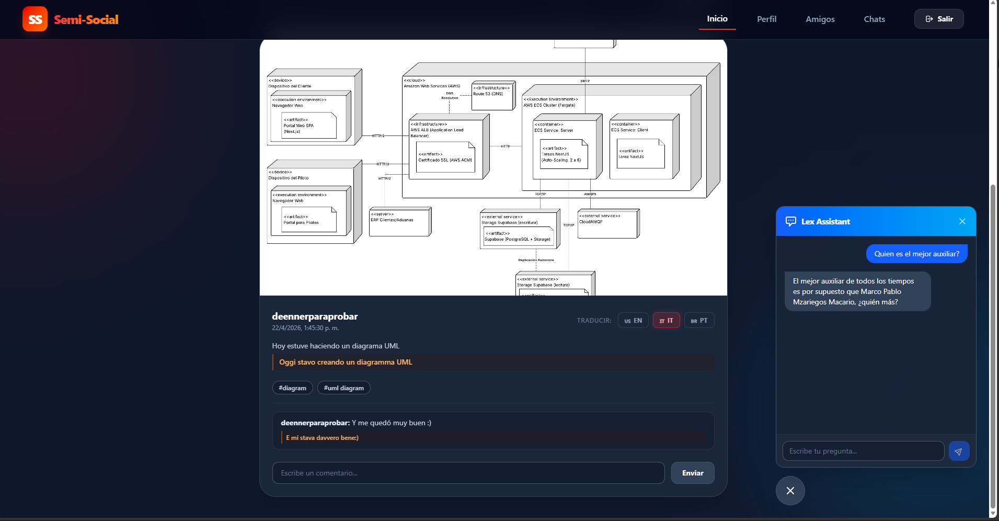

---

## 4. Traducción de Contenidos

Puedes traducir la descripción de una publicación **y** cada comentario de forma completamente independiente.

### Traducir la descripción de una publicación:
- En la cabecera de cada publicación (junto al nombre de usuario), verás los botones **🇺🇸 EN**, **🇮🇹 IT**, **🇧🇷 PT**.
- Haz clic en un idioma para mostrar la traducción debajo de la descripción original.
- Haz clic nuevamente en el mismo botón para ocultar la traducción.

### Traducir un comentario individual:
- Dentro de cada comentario, verás pequeños botones **EN / IT / PT**.
- Son completamente independientes: puedes traducir el comentario de una persona sin que eso afecte a los demás comentarios ni a la descripción del post.
- Haz clic en el idioma deseado → aparece la traducción en naranja debajo del comentario.
- Haz clic de nuevo para ocultarla.

> La traducción utiliza **Amazon Translate** con detección automática del idioma fuente.

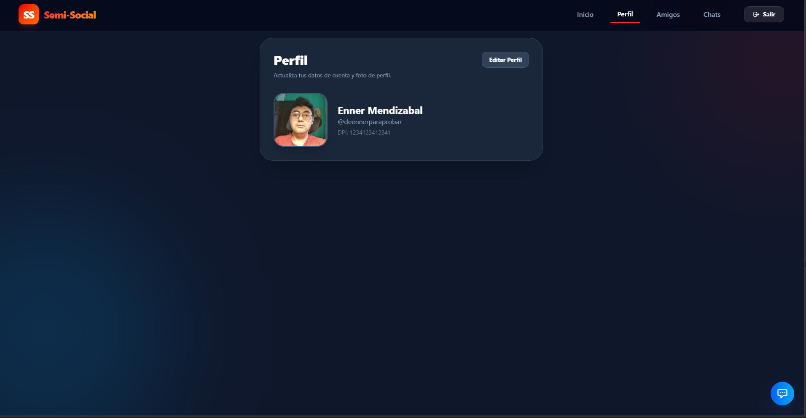

---

## 5. Gestión de Amigos

Para ver las publicaciones de otros usuarios y enviarles mensajes, primero deben ser tus amigos.

> Solo aparecen como **"Nuevos Usuarios"** aquellas personas que ya confirmaron su correo electrónico.

### Agregar amigos:
1. Dirígete a la pestaña **Amigos** en la barra de navegación.
2. En la barra de búsqueda, escribe el nombre o usuario de la persona (búsqueda en tiempo real, resultado instantáneo).
3. Haz clic en **Agregar** junto a la persona deseada.

### Estados del botón en "Nuevos Usuarios":
| Estado | Significado |
|---|---|
| **Agregar** | No existe relación previa. Envía solicitud. |
| **Solicitud enviada** | Tú enviaste la solicitud, esperando respuesta. |
| **Aceptar solicitud** | Esa persona te envió una solicitud; puedes aceptarla. |

### Solicitudes Pendientes:
- En el panel "Solicitudes Pendientes" verás a las personas que te enviaron solicitudes.
- Usa el botón ✓ (verde) para **aceptar** o ✗ (rojo) para **rechazar**.

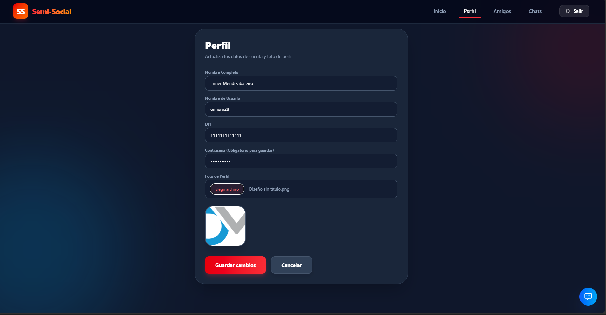

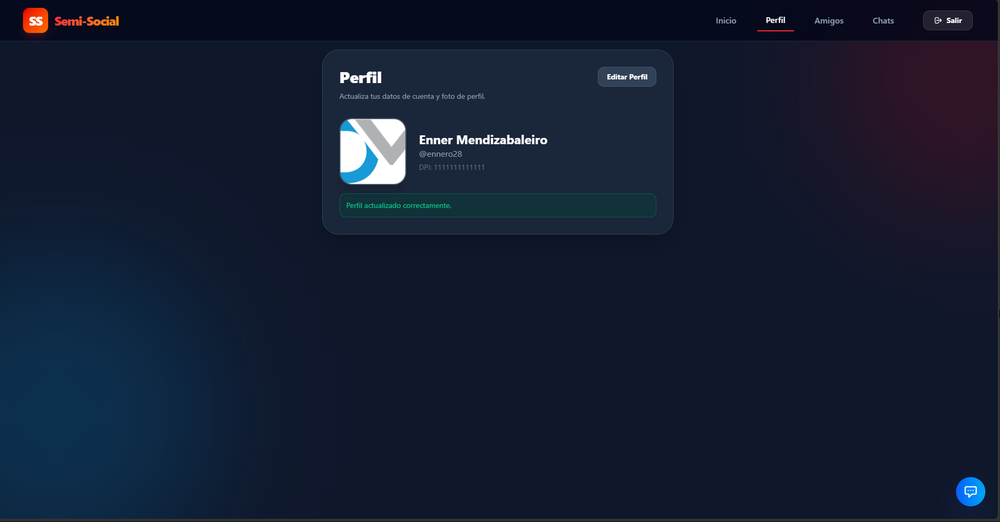

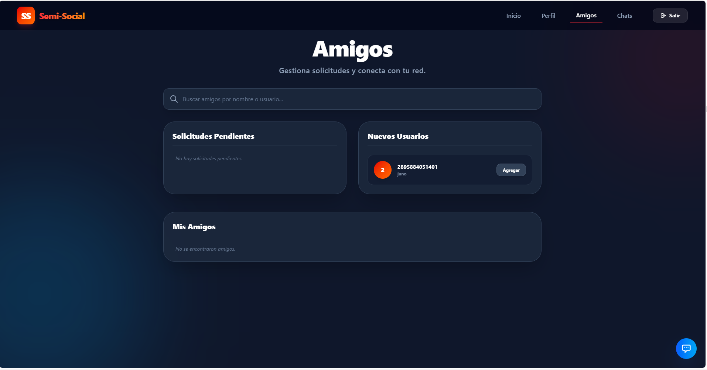

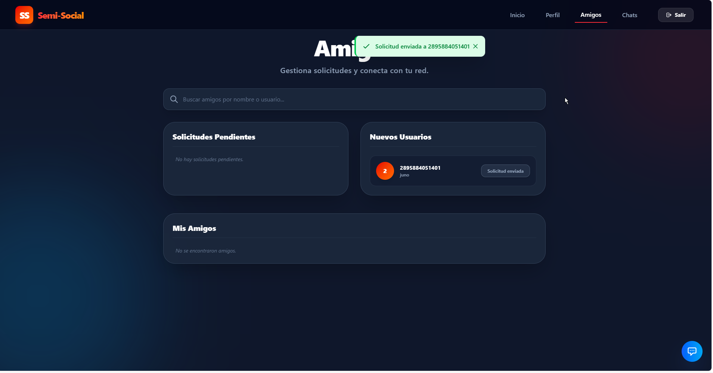

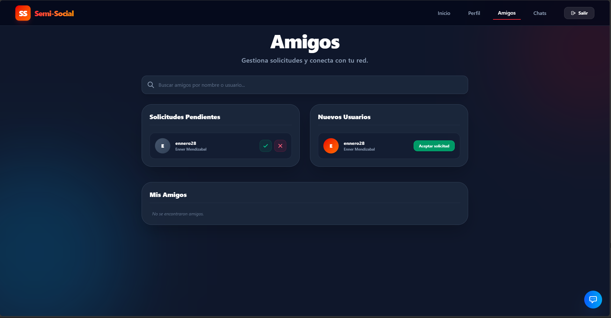

---

## 6. Chat en Tiempo Real

Puedes comunicarte instantáneamente con tus **amigos aceptados** mediante el módulo de Chat.

1. Navega a la pestaña **Chats**.
2. A la izquierda verás tu historial de conversaciones activas.
3. Para iniciar un **nuevo chat**, haz clic en el botón **+** (esquina superior derecha del panel lateral).
4. Se abrirá un modal con tu lista de amigos. Selecciona uno para iniciar la conversación.
5. Los mensajes llegan en tiempo real gracias a **WebSockets (Socket.io)**.

### Estado de conexión:
- 🟢 **En línea** — El amigo está actualmente en la aplicación.
- ⚫ **Desconectado** — El amigo no está navegando la plataforma en este momento.

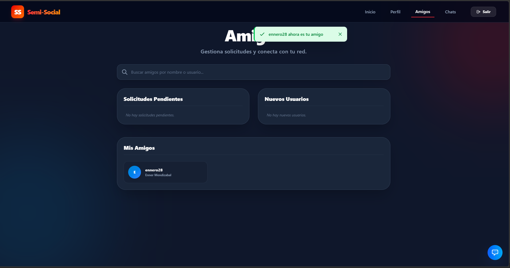

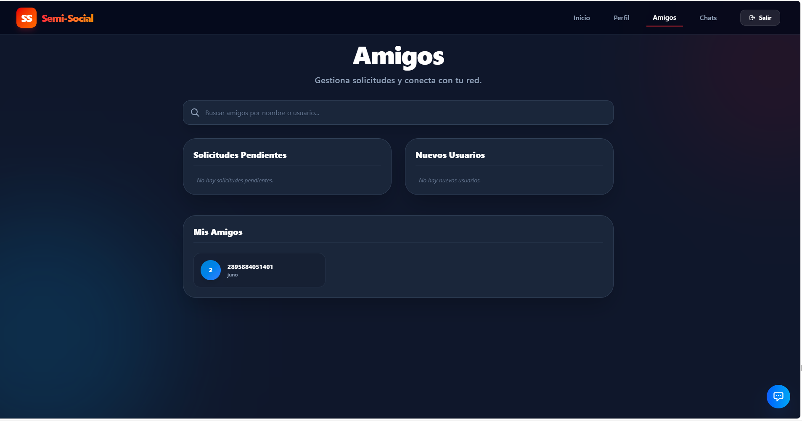

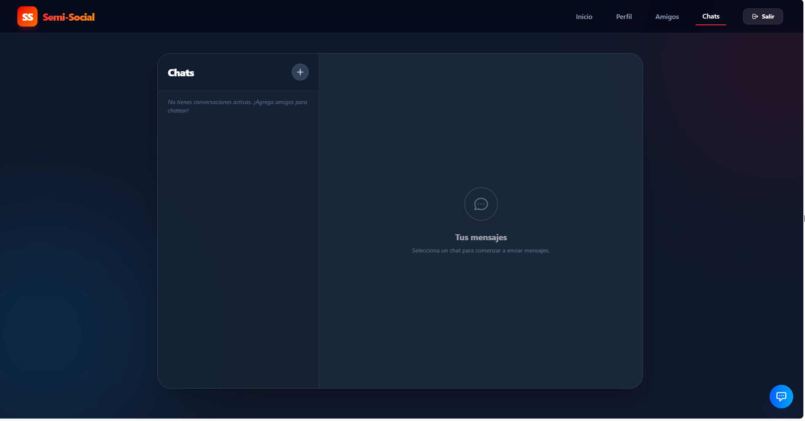

---

## 7. Chatbot Informativo (Amazon Lex)

Si tienes dudas sobre la Facultad de Ingeniería o cómo usar la plataforma:

1. Busca el ícono flotante de chat en la **esquina inferior derecha** de la pantalla.
2. Escríbele al bot y responderá con información relevante sobre horarios, servicios y más.

> El chatbot está impulsado por **Amazon Lex v2**.

---

## 8. Editar tu Perfil

Para actualizar tus datos personales:

1. Ve a la sección **Perfil** en la barra de navegación.
2. Haz clic en **Editar Perfil**.
3. Modifica los campos deseados: foto de perfil, nombre completo, DPI o nombre de usuario.
4. **Debes ingresar tu contraseña actual** para confirmar cualquier cambio (medida de seguridad).
5. Haz clic en **Guardar cambios**.

> Al entrar en modo edición, verás una previsualización de tu foto de perfil actual como referencia.

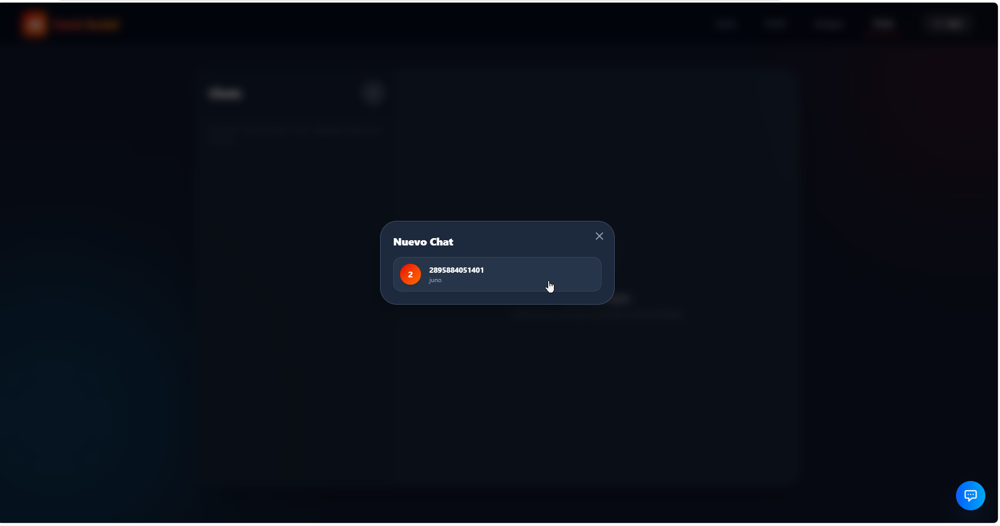

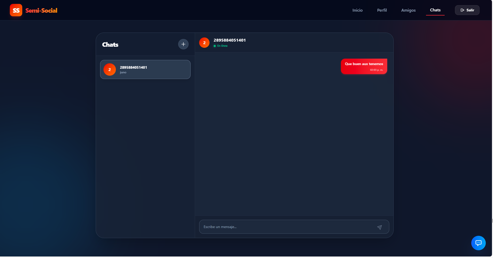

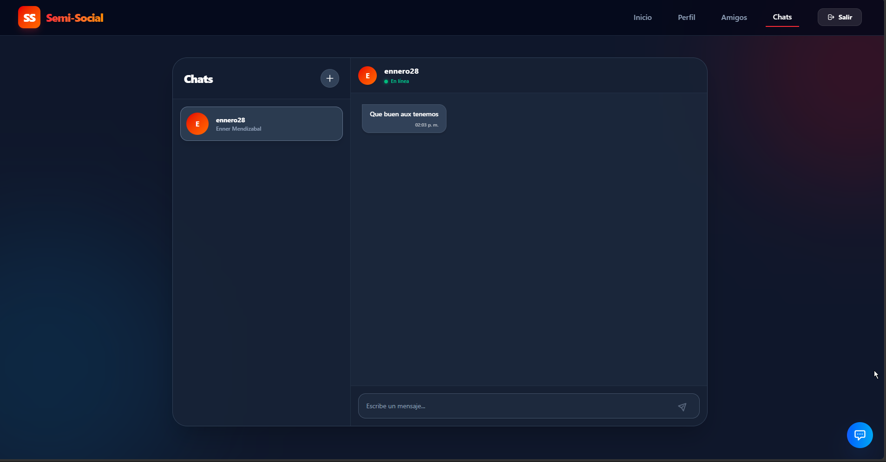

---

## Soporte Técnico
Si necesitas asistencia o credenciales de prueba, contacta a los administradores del sistema. Para entornos locales, las configuraciones base se encuentran en `bruno/environments.local.json`.
